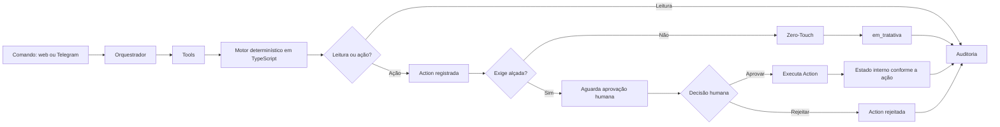
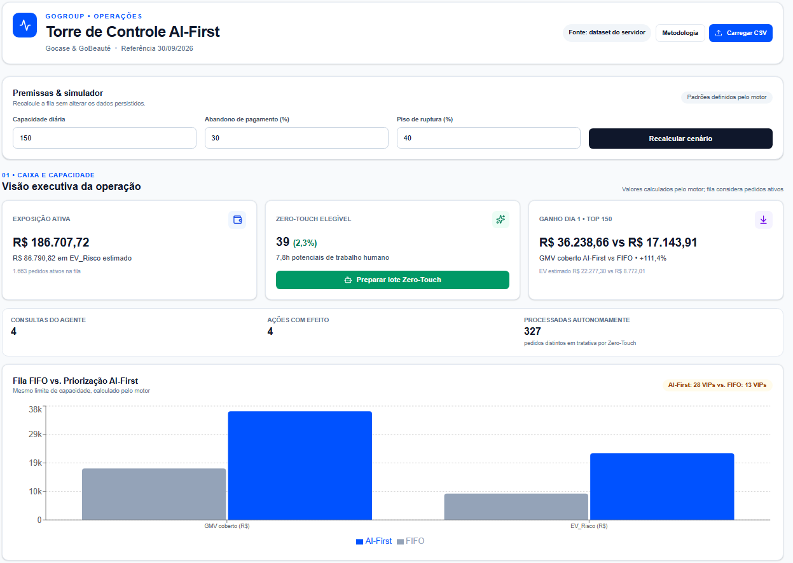
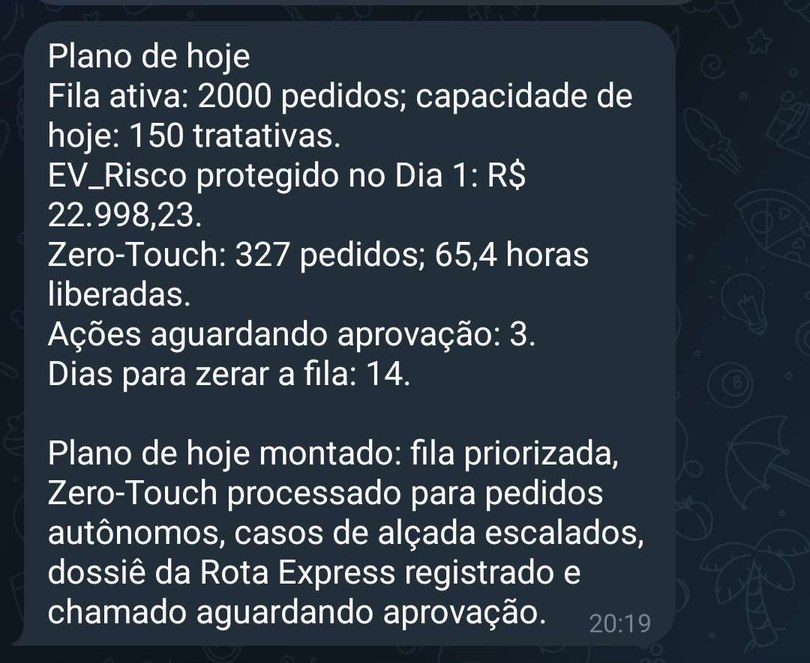
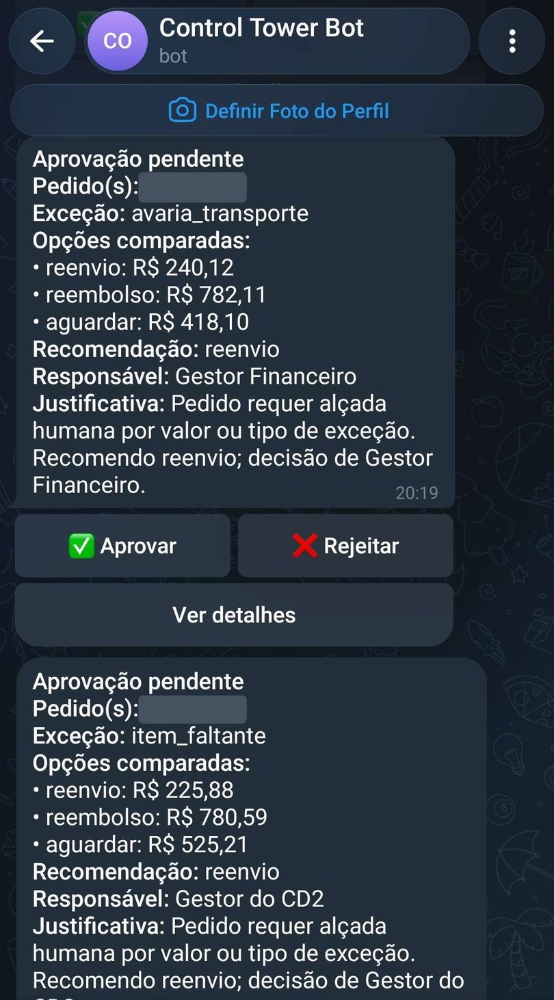
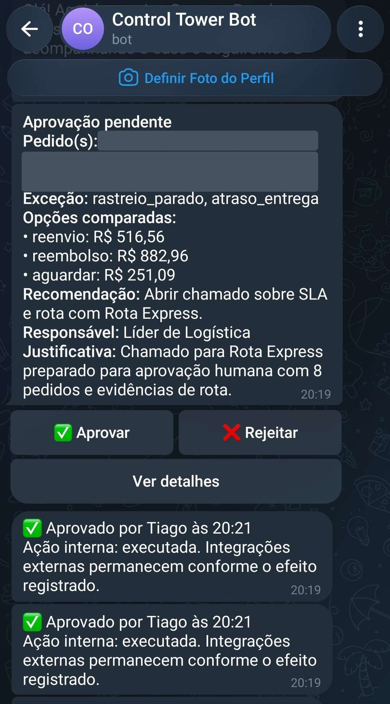
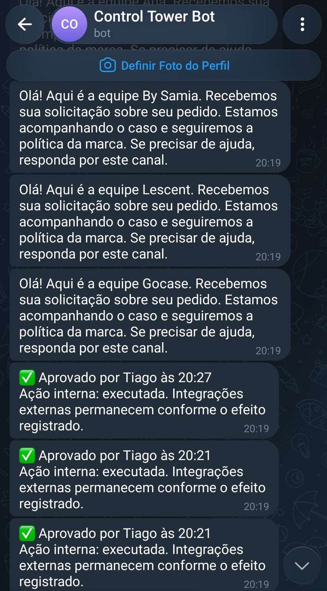
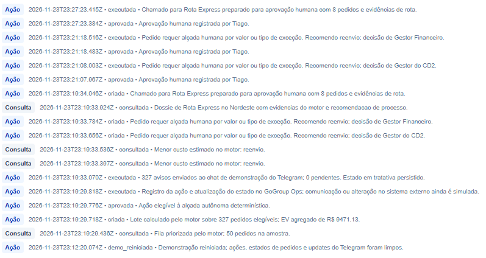

# Torre de Controle AI-First — Operações GoGroup

Um colega agente de Operações que prioriza 2.000 pedidos em exceção, atua sozinho no que está dentro da alçada e chama a pessoa certa quando precisa de decisão.

**Demonstração pública:** https://gogroup-ops-control-tower.vercel.app

## Como testar em 30 segundos

1. Abra o [link público](https://gogroup-ops-control-tower.vercel.app).
2. Clique em **Preparar lote Zero-Touch** e depois em uma ação pendente de alçada para aprová-la.
3. Confira a trilha e a auditoria.
4. Clique em **Reiniciar demonstração** para restaurar o estado compartilhado para todos os visitantes.

## O problema e a usuária

- **Problema modelado:** priorizar e tratar uma fila de exceções de pedidos com uma regra comum de risco e capacidade.
- **Usuária de referência:** Marina, persona de apresentação de uma analista de Operações; não é uma pessoa entrevistada.
- **Limite da hipótese:** o processo da GoGroup e as políticas de alçada ainda precisam ser validados com a equipe.

## O que os dados revelaram

- O snapshot de referência usado pelo motor contém 2.000 pedidos.
- No checkout, a promessa de entrega comparava dias corridos com dias úteis; o cálculo considera os feriados de 07/09 e 12/10.
- As regras identificam ocorrências no CD2 no turno da noite associadas a itens faltantes e brindes, além de falhas de personalização na IMP-02.
- Também identificam ocorrências da Rota Express no Nordeste e o vazamento do lote L2607-B associado ao SKU APC-1067.
- Avarias da Carga Norte em Lescent e rupturas pós-venda de Kokeshi completam as sete regras de causa-raiz do motor.

## O que o agente faz sozinho × onde chama um humano

| Situação | Comportamento atual |
| --- | --- |
| Zero-Touch sem alçada | Executa os casos elegíveis definidos pelo motor e registra o estado interno `em_tratativa`. O aviso é simulado sem Telegram; com Telegram configurado, vai ao chat de demonstração. |
| Comunicação individual | O sub-agente chama o modelo com fatos do motor e valida o rascunho (ou usa template determinístico); a Action aguarda aprovação. Só envia após aprovação ao chat de demonstração configurado; rejeitar não envia. |
| Mensagem do lote Zero-Touch | Agrupa mensagens por marca, registra texto e pedidos na Action/trilha e envia ao chat de demonstração sem aprovação individual, se o Telegram estiver configurado. |
| Chamado à transportadora | Registra um chamado simulado como Action pendente de aprovação; não chama o sistema da transportadora. |
| VIP, valor acima de R$ 250 ou ruptura pós-venda | O motor exige alçada humana. R$ 250 é uma premissa editável, não um limite informado como dado real da GoGroup. |

## Fluxo de uma solicitação

Com Groq, o Orquestrador percorre um loop limitado de ferramentas e as roteia para Triagem, Investigador ou Comunicação. Comunicação faz uma chamada própria ao modelo; sem chave Groq, os fluxos previstos usam o fallback determinístico.



Consultas somente leitura são registradas sem criar Action com efeito. O estado interno só muda quando a ação prevê essa transição; uma Action de comunicação individual, por exemplo, não muda o estado do pedido.

## Resultados do motor

| Tipo | Indicador | Resultado de referência |
| --- | --- | ---: |
| Processo | Pedidos únicos | 2.000 |
| Processo | Zero-Touch elegível sem alçada humana | 327 (16,35% da fila) |
| Processo | Horas teóricas poupadas pelos casos autônomos | 65,4 h |
| Processo | Dias para processar a fila a 150/dia: FIFO e prioridade | 14 dias em ambos |
| Impacto estimado | GMV na fila | R$ 220.161,37 |
| Impacto estimado | EV_Risco total | R$ 97.456,36 |
| Impacto estimado | EV_Risco no Dia 1: FIFO | R$ 8.290,25 |
| Impacto estimado | EV_Risco no Dia 1: prioridade por EV_Risco | R$ 22.998,23 |
| Impacto estimado | Incremento de EV_Risco priorizado no Dia 1 | R$ 14.707,98 |

São estimativas do motor calculadas sobre a cópia local privada do snapshot de referência; o clone público usa fixture sintética e pode mostrar outros totais. EV_Risco priorizado não é dinheiro recuperado nem perda evitada. As horas são teóricas (12 minutos por caso); a base não registra desfechos reais das tratativas.

Em linguagem simples: no Dia 1, a prioridade põe R$ 22.998,23 de risco estimado sob tratamento, contra R$ 8.290,25 no FIFO; isso não significa perda evitada.

## Demonstração

Prints feitos neste ambiente, com dados fictícios do desafio. Nenhum dado bruto está no repositório e os IDs de pedido foram omitidos.

### Painel web



Estado após executar o Zero-Touch e aprovar 3 ações; consultas do agente separadas de ações com efeito.

### Agente no Telegram

| Plano do dia | Cartões de aprovação |
| --- | --- |
| <br>Plano do dia | <br>Cartões de aprovação |
| <br>Chamado aprovado | <br>Comunicação por marca e aprovações |

O webhook do Telegram aceita apenas os chats autorizados pela configuração; os prints mostram o chat configurado para demonstração.

### Trilha e auditoria



Consultas (somente leitura) separadas de ações com efeito; cada aprovação humana fica registrada.

## O que é real × o que é simulado

| Parte | Estado atual |
| --- | --- |
| Custos, EV_Risco, prazos úteis, capacidade e fila | Calculados deterministicamente pelo motor TypeScript. |
| Actions, estados e auditoria | No Upstash quando configurado; sem ele, na memória do processo, que não compartilha estado entre instâncias. |
| Aprovação humana | A decisão é persistida no store e pode ser feita na web ou nos botões do Telegram autorizado. |
| Zero-Touch e avisos | O efeito interno é registrado; o envio externo é simulado sem Telegram e, quando configurado, enviado somente ao chat de demonstração. |
| Comunicação individual | Rascunho registrado e pendente; envio ao chat demo somente após aprovação. Rejeição não envia. |
| Chamados e integrações externas | Chamado de transportadora é simulado e pendente; ERP, WMS, pagamento, transportadoras e WhatsApp Business não estão conectados. |
| Groq | Opcional para seleção de ferramentas e redação; o fallback determinístico funciona sem chave. O modelo não calcula valores nem prazos. |

Executar uma Action não prova que o problema externo foi solucionado. O pedido não é marcado como resolvido apenas por uma mensagem ou aprovação.

## Decisões e trade-offs

- Mantive o motor TypeScript como única fonte de dinheiro, risco, prazo e alçada; o LLM escolhe ferramentas e redige texto.
- Mantive um fallback determinístico para os fluxos operacionais quando Groq está indisponível ou sem chave.
- Exijo aprovação humana para comunicação individual, chamados e casos que excedem alçada; Zero-Touch atua só nos casos elegíveis sem alçada.
- Rotulei dados oficiais e premissas editáveis para deixar claro o que precisa de validação.
- Separei consultas somente leitura de Actions com efeito para não contar análise como execução.

## Como usei IA no desenvolvimento

- Usei Codex para implementar e outra IA (Claude) como parceira de análise e planejamento; as decisões e correções foram minhas.
- Quando a leitura inicial de contexto foi parcial, pedi evidências concretas antes de aceitar conclusões.
- Corrigi a hipótese de prazo em dias corridos e duplicatas, preservei SKUs necessários às regras e descartei uma probabilidade de ruptura sem fonte.
- Registrei erros, correções e aprendizados em [docs/AI_LOG.md](docs/AI_LOG.md).

## Limites e próximos passos

- Conectar ERP, WMS, pagamento, transportadoras e WhatsApp somente após validação de acesso e alçadas.
- Registrar desfechos observados para medir resolução e resultado; hoje a base não os contém.
- As sete causas usam regras calibradas neste dataset; o próximo passo é um detector estatístico por dimensão (CD, lote, transportadora, UF, turno).
- Validar fila, política de contato, premissas e responsáveis com a equipe de Operações.
- Proponho um piloto em sombra de 30 dias para comparar recomendações, decisões e desfechos antes de habilitar escrita externa.

## Rodar localmente

Requisitos: Node.js e npm. Sem variáveis externas, a aplicação usa a demonstração sintética.

```sh
npm install
npm run dev
```

Abra `http://localhost:3000`. Sem `data/private/snapshot_2000.json`, o motor carrega `data/demo_fallback.json`. Para métricas da demo sintética, rode `npm run metrics -- --demo`.

Para validar mudanças, rode `npm test`, `npm run lint` e `npm run build`.

`npm test` tem 42 testes. O workflow `.github/workflows/ci.yml` executa lint, testes e build em pushes e pull requests.

### Variáveis opcionais

- `GROQ_API_KEY`: habilita seleção de ferramentas pelo Groq; sem chave, usa fallback determinístico.
- `UPSTASH_REDIS_REST_URL` e `UPSTASH_REDIS_REST_TOKEN`: store compartilhado; sem eles, o estado fica na memória do processo.
- `TELEGRAM_BOT_TOKEN`, `TELEGRAM_WEBHOOK_SECRET`, `TELEGRAM_TEAM_CHAT_ID` e `TELEGRAM_DEMO_CUSTOMER_CHAT_ID`: webhook, aprovações e chat privado de demonstração. Veja [docs/TELEGRAM.md](docs/TELEGRAM.md).
- `CRON_SECRET`: protege o endpoint de briefing agendado.

### Privacidade e documentação

Não versiono CSVs, PDFs, ZIPs, `.env*`, arquivos de `data/raw/` ou o snapshot privado em `data/private/`. Os prints e a fixture pública usam dados fictícios; não inclua registros ou identificadores privados no repositório.

- [Metodologia e parâmetros](docs/METODOLOGIA.md)
- [Métricas, sensibilidade e limites](docs/METRICAS.md)
- [Visão 360° e implantação](docs/VISAO_360.md)
- [Telegram](docs/TELEGRAM.md)
- [Registro de trabalho assistido por IA](docs/AI_LOG.md)
